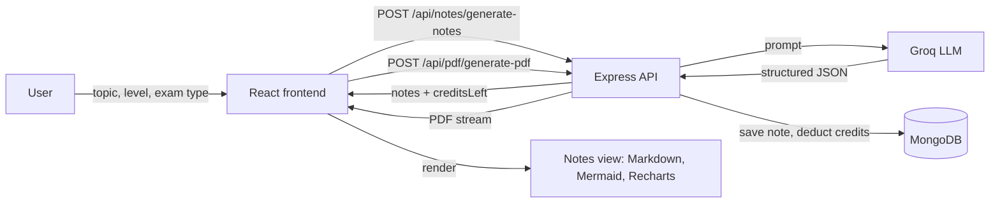

# 📘 ExamNotes AI

**AI-powered, exam-oriented notes and quick revision, generated in seconds.**


Enter a topic, your class or level, and your exam type. ExamNotes AI returns priority-ranked sub topics, detailed notes, revision points, likely exam questions, and optional flowcharts and charts. You can download everything as a PDF and revisit your saved notes any time.


🔗 **Live demo:** https://frontend-ainotesgenerator.onrender.com/

> **Note:** the backend runs on a free hosting tier, so the first request after a period of inactivity can take up to a minute while the server wakes up.

---

## 📑 Table of Contents

1. [Features](#-features)
2. [Screenshots](#-screenshots)
3. [How It Works](#-how-it-works)
4. [Tech Stack](#-tech-stack)
5. [Project Structure](#-project-structure)
6. [Data Shape of Generated Notes](#-data-shape-of-generated-notes)
7. [API Reference](#-api-reference)
8. [Credits and Payments](#-credits-and-payments)
9. [Getting Started](#-getting-started)
10. [Environment Variables](#-environment-variables)
11. [Deployment](#-deployment)
12. [Security Notes](#-security-notes)
13. [Troubleshooting](#-troubleshooting)
14. [Roadmap](#-roadmap)
15. [Acknowledgements](#-acknowledgements)
16. [Author](#-author)

---

## ✨ Features

**Note generation**
- Generate notes from three inputs: **topic**, **class / level** and **exam type** (for example CBSE, JEE or NEET).
- **Exam Revision Mode** for a condensed *Quick Revision (5 min)* version.
- **Include Diagram** adds a flowchart rendered with Mermaid.
- **Include Charts** adds data charts rendered with Recharts.

**Output sections**
- **Quick Exam View:** sub topics grouped by priority (high, medium and low).
- **Detailed Notes:** a section for each sub topic, with a priority badge.
- **Revision Points:** short bullet points for last-minute revision.
- **Important Questions:** short questions, long questions and a diagram question.

**Productivity**
- 📄 **Download as PDF**, generated on the server with PDFKit.
- 🗂️ **History:** a sidebar lists every saved note, and clicking one loads the full content.
- 📱 Responsive layout with an animated slide-in sidebar on mobile.

**Accounts and credits**
- Secure login with JWT stored in HTTP-only cookies.
- A **credit system**: each generation uses credits, and users can buy more.
- 💳 **Stripe Checkout** with a webhook that adds credits only after a confirmed payment.

---

## ⚙️ How It Works



1. The frontend sends the form data to the backend, along with the login cookie.
2. The backend checks the user, builds a prompt and asks the language model for a **structured JSON** response.
3. The note is saved to MongoDB, credits are deducted and the result is returned.
4. The frontend renders the notes, flowchart and charts. PDF download streams a generated PDF from the server.

---

## 🧰 Tech Stack

| Layer | Technologies |
|---|---|
| **Frontend** | React (Vite), React Router, Redux Toolkit, Tailwind CSS, Motion (animations), Axios, React Icons |
| **Rendering** | Markdown renderer, Mermaid (flowcharts), Recharts (charts), html2pdf.js |
| **Backend** | Node.js, Express |
| **Database** | MongoDB with Mongoose |
| **AI** | Groq API (LLM returning structured JSON), with retry handling |
| **Auth** | JWT in HTTP-only cookies, `cookie-parser`, CORS with credentials |
| **PDF** | PDFKit (server-side) |
| **Payments** | Stripe Checkout and webhooks |
| **Hosting** | Render (static site for the frontend, web service for the backend) |

---

## 📁 Project Structure

```
AiNotesGenerator/
├── frontend/
│   ├── public/
│   └── src/
│       ├── assets/
│       ├── components/        # FinalResult, Markdownrenderer, Mermaidchart,
│       │                      # Rechartsetup, TopicForm, Navbar, Sidebar, Footer
│       ├── pages/             # Home, Auth, Notes, History, Pricing,
│       │                      # PaymentSuccess, PaymentFailed
│       ├── redux/             # store.js, userSlice.js
│       ├── services/          # api.js (all API calls)
│       ├── utils/
│       ├── App.jsx            # routes and exported serverUrl
│       └── main.jsx
│
└── server/
    ├── controllers/           # auth, user, generate, notes, pdf, credits
    ├── middleware/            # isAuth.js (verifies the login cookie)
    ├── models/                # user, notes, payment
    ├── routes/                # auth, user, generate, pdf, credit
    ├── services/              # AI service
    ├── utils/                 # database connection, prompt builder, token helpers
    ├── index.js               # app entry, webhook route and middleware order
    └── .env                   # secrets (never committed)
```

> The tree is abbreviated. Check the repository for the exact file list.

---

## 🧾 Data Shape of Generated Notes

The AI returns one JSON object, which is stored and rendered by the frontend:

```json
{
  "subTopics": [
    { "title": "HTML Basics", "importance": "high", "notes": "HTML is the skeleton of a web page..." }
  ],
  "revisionPoints": ["HTML tags form the page structure.", "..."],
  "questions": {
    "short": ["..."],
    "long": ["..."],
    "diagram": "Draw a flowchart showing the steps from a user entering a URL..."
  },
  "diagram": { "type": "flowchart", "title": "Web Development Process", "...": "..." },
  "charts": []
}
```

**Notes model fields:** `user`, `topic`, `classLevel`, `examType`, `revisionMode`, `includeDiagram`, `includeChart`, `content` and `createdAt`.

---

## 🔌 API Reference

All routes except the Stripe webhook require the login cookie (`isAuth` middleware).

| Method | Endpoint | Description |
|---|---|---|
| `GET` | `/api/user/getCurrentUser` | Returns the logged-in user, including their credit balance |
| `POST` | `/api/notes/generate-notes` | Generates and saves notes, then returns `{ data, noteId, creditsLeft }` |
| `GET` | `/api/notes/get-my-notes` | Lists the user's saved notes (summary fields only) |
| `GET` | `/api/notes/:id` | Returns the full content of one of the user's notes |
| `POST` | `/api/pdf/generate-pdf` | Streams a PDF built from the posted notes |
| `POST` | `/api/credit/order` | Creates a Stripe Checkout session and returns `{ url }` |
| `POST` | `/api/payment/webhook` | Stripe webhook (signature verified, uses the raw request body) |
| `*` | `/api/auth/*` | Signup, login and logout |

**Example: create a checkout session**

```http
POST /api/credit/order
Content-Type: application/json

{ "amount": 200 }
```

```json
{ "url": "https://checkout.stripe.com/c/pay/cs_test_..." }
```

---

## 💳 Credits and Payments

| Plan | Price | Credits received |
|---|---|---|
| Starter | ₹100 | 100 |
| Popular | ₹200 | 250 |
| Pro | ₹500 | 1000 |

**Payment flow**

1. The user picks a plan, and the frontend calls `POST /api/credit/order` with the plan price.
2. The server checks the price against its own `CREDIT_MAP` (the browser can't set its own price), creates a Stripe Checkout session and returns the URL.
3. The user pays on Stripe's hosted page and is redirected to `/payment-success`, or to `/payment-failed` if they go back.
4. Stripe calls `/api/payment/webhook` with a signed `checkout.session.completed` event.
5. The server verifies the signature, records the payment (a unique session id prevents double crediting) and adds the credits.

> **Credits are added only by the webhook**, never by the success page. Opening `/payment-success` by hand gives nobody credits.

Stripe is used in **test mode** by default. UPI is not available for Stripe accounts in India, so only cards are accepted.

---

## 🚀 Getting Started

### Prerequisites

- Node.js 18 or newer (developed on Node 22)
- A MongoDB database (local or MongoDB Atlas)
- A [Groq](https://console.groq.com) API key
- A [Stripe](https://stripe.com) account (test mode) and the [Stripe CLI](https://stripe.com/docs/stripe-cli)

### 1. Clone the repository

```bash
git clone https://github.com/Raghuraj-stack/AiNotesGenerator.git
cd AiNotesGenerator
```

### 2. Set up the backend

```bash
cd server
npm install
```

Create `server/.env` (see [Environment Variables](#-environment-variables)), then start it:

```bash
npm run dev
```

The API runs on `http://localhost:8000`.

### 3. Set up the frontend

```bash
cd ../frontend
npm install
npm run dev
```

The app runs on `http://localhost:5173`.

### 4. Forward Stripe webhooks (for credit purchases)

In a third terminal:

```bash
stripe login
stripe listen --forward-to localhost:8000/api/payment/webhook
```

Copy the `whsec_...` secret it prints into `STRIPE_WEBHOOK_SECRET`, then restart the server. Pay with the Stripe test card `4242 4242 4242 4242`, any future expiry date and any CVC.

---

## 🔐 Environment Variables

**`server/.env`**

```env
PORT=8000
MONGODB_URL=your_mongodb_connection_string
JWT_SECRET=a_long_random_string
GROQ_API_KEY=your_groq_api_key
STRIPE_SECRET_KEY=sk_test_...
STRIPE_WEBHOOK_SECRET=whsec_...
CLIENT_URL=http://localhost:5173
```

> Use the variable names your code actually reads (check `server/utils` and the controllers). Never commit `.env`. It is listed in `.gitignore`.

**`frontend/.env`** (recommended for deployment)

```env
VITE_SERVER_URL=http://localhost:8000
```

Then use `export const serverUrl = import.meta.env.VITE_SERVER_URL;` in `App.jsx`.

---

## ☁️ Deployment

The project is deployed on **Render**.

**Frontend (Static Site)**

| Setting | Value |
|---|---|
| Root Directory | `frontend` |
| Build Command | `npm install && npm run build` |
| Publish Directory | `dist` |
| Rewrite rule | `/*` → `/index.html` (needed for React Router) |
| Environment | `VITE_SERVER_URL` = your backend URL |

**Backend (Web Service)**

| Setting | Value |
|---|---|
| Root Directory | `server` |
| Build Command | `npm install` |
| Start Command | `node index.js` |
| Environment | every variable from `server/.env`, using production values |

**Production checklist**

- [ ] `CLIENT_URL` and the CORS `origin` point to the deployed frontend URL.
- [ ] The login cookie uses `sameSite: "none"` and `secure: true`, because the frontend and backend are on different domains.
- [ ] A Stripe webhook endpoint is added in the Stripe Dashboard: `https://<your-backend>/api/payment/webhook`, with the event `checkout.session.completed`, and its signing secret is set as `STRIPE_WEBHOOK_SECRET`.
- [ ] Live keys are used instead of test keys only when you are ready to take real payments.

---

## 🛡️ Security Notes

- Secrets live only in environment variables and are excluded from Git.
- Passwords and sessions use JWT in HTTP-only cookies, with CORS restricted to the frontend origin.
- Credit prices are decided **on the server**. The client only sends the plan.
- Stripe webhooks are verified with the signing secret, and the route uses the raw request body.
- Payments are stored with a unique session id, so a repeated webhook can't add credits twice.
- Notes are always queried with the logged-in user's id, so users can't read each other's notes.

---

## 🧯 Troubleshooting

| Problem | Likely cause and fix |
|---|---|
| Build fails on Render with `Could not resolve './SomeFile'` | **File name capitalization.** Windows ignores case, Linux does not. Make every import match the file name exactly (for example `Mermaidchart`, not `MermaidChart`). |
| Server crashes with `Neither apiKey nor config.authenticator provided` | The `.env` file loaded after the Stripe client was created. Use `import "dotenv/config"` as the **first** import in `index.js`. |
| Stripe error about `payment_method_types` | Newer Stripe API versions no longer accept this option. Remove it and manage payment methods in the Stripe Dashboard. |
| Webhook returns 400 | `STRIPE_WEBHOOK_SECRET` is wrong, or `express.json()` runs before the webhook route. The webhook route must come first and use `express.raw`. |
| Credits don't update after paying | The webhook may not have run. Check the Stripe CLI output and the server logs. |
| Logged out after deploying | Cross-site cookies need `sameSite: "none"` and `secure: true`, and `withCredentials: true` on every request. |
| Pages show "Not Found" when refreshed | Add the `/*` → `/index.html` rewrite on the static site. |

---

## 🗺️ Roadmap

- [ ] Draw the generated flowchart and charts inside the downloaded PDF.
- [ ] Add UPI payments through a gateway that supports it (for example Razorpay).
- [ ] Add delete and rename for saved notes.
- [ ] Add search and filters in the history sidebar.
- [ ] Add rate limiting and request validation on the API.
- [ ] Add automated tests for the controllers and the payment flow.
- [ ] Add a dark mode toggle.

---

## 🙏 Acknowledgements

- Built while following the *"I Built an AI Exam Notes Generator | MERN + Stripe"* tutorial by **Virtual Code** on YouTube, then extended with a history view, a Groq-based generation pipeline, payment handling fixes and deployment.
- [Groq](https://groq.com), [Stripe](https://stripe.com), [Mermaid](https://mermaid.js.org) and [Recharts](https://recharts.org).

---

## 👤 Author

**Raghuraj**
GitHub: [@Raghuraj-stack](https://github.com/Raghuraj-stack)

If this project helped you, consider giving it a ⭐ on GitHub.
